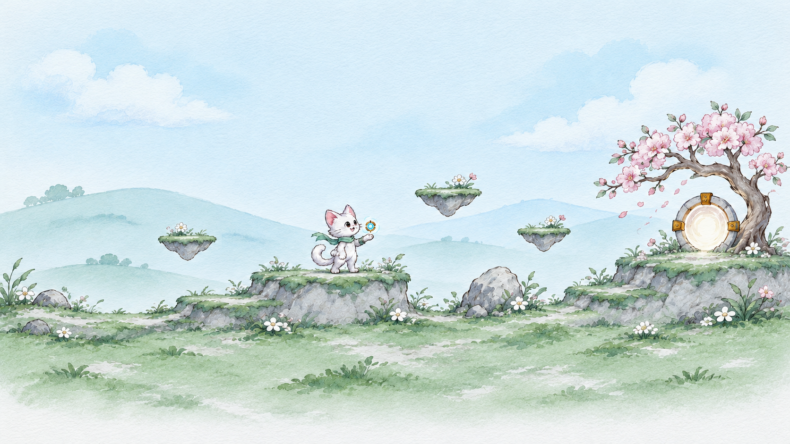
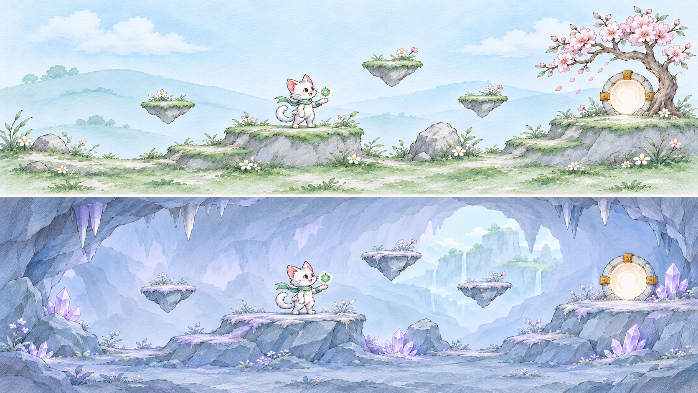
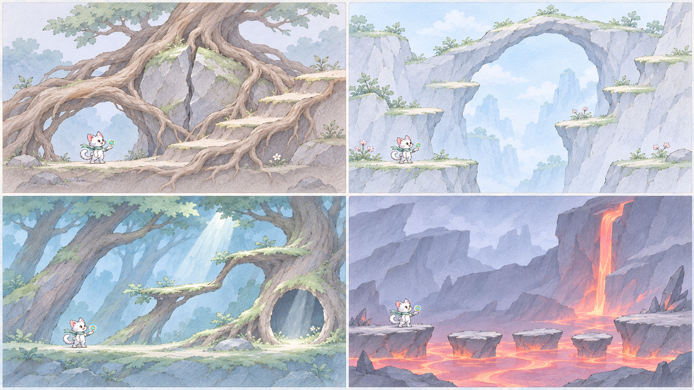
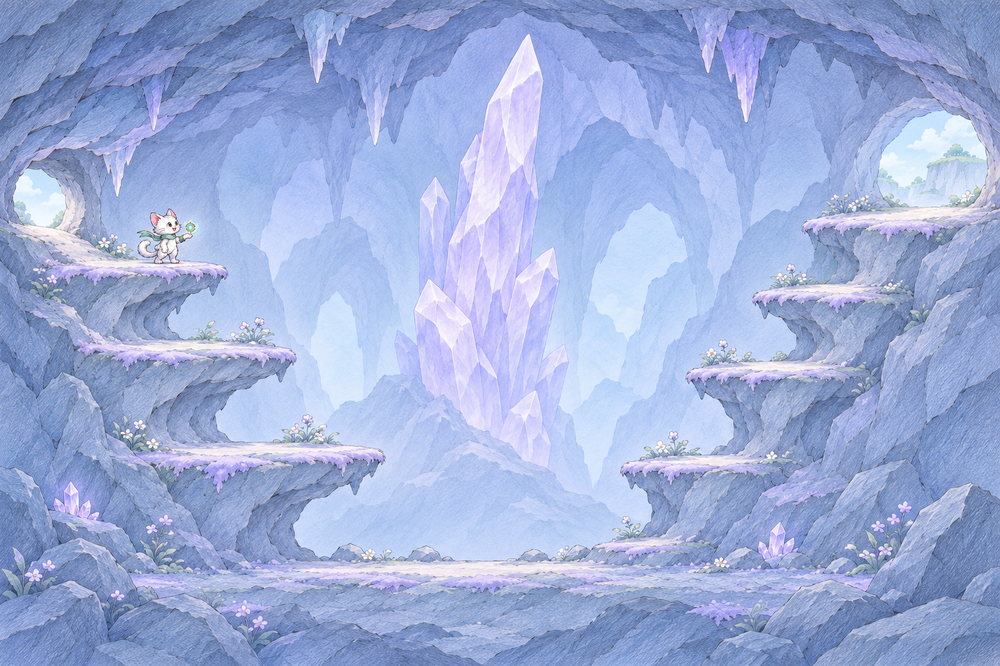
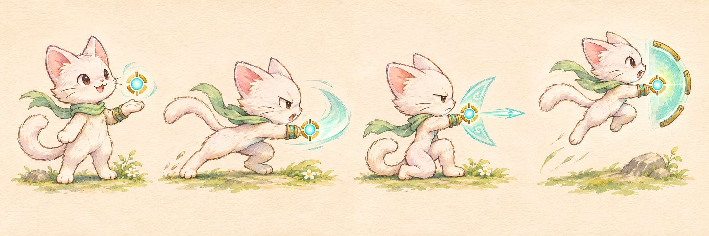

# Hướng mỹ thuật — Hành trình của Dang Dang

Tài liệu hướng mỹ thuật cho bản remake. Thiết kế nhân vật và nguyên lý quả cầu đã chốt. Phong cách thế giới đang được thử tiếp, lấy mặt đất trong concept nhân vật làm chuẩn tham chiếu.

## Thế giới — hướng đang thử

Lấy cụm đất, đá và hoa ngay dưới chân mèo trong concept nhân vật làm mẫu cho địa hình. Dùng viền chì nâu mảnh, nét gạch ngắn trong bóng đá và màu nước loang nhẹ để mặt đất có cùng chất vẽ với Dang Dang. Đá xám ấm và đất vàng nhạt đi cùng rêu xanh ô liu, cỏ thấp, hoa kem và hoa đào mọc thưa. Dùng ánh sáng ban ngày dịu và giữ nền xa nhạt hơn mặt đất.

Giữ nền giấy trắng dịu, ánh sáng ban ngày trung tính, trời xanh nhạt, đá xám và rêu xanh dịu. Giữ lông mèo trắng với bóng xám nhẹ. Dùng màu vàng hổ phách cục bộ ở cổng và các chi tiết đồng trên quả cầu. Tránh phủ vàng kem hoặc sepia lên cả khung hình. [Bản thử tông ấm trước đó](storybook-ground-study.png) dùng để đối chiếu.

Bản thử mở rộng cụm đất dưới chân mèo thành sàn và bệ nhảy. Bố cục đồi thoáng và dáng cổng trong ảnh là ví dụ để kiểm tra chất vẽ. [Concept hang đá vôi trước đó](bright-limestone-grotto.png) được lưu để đối chiếu.

- Vẽ địa hình thành khối đá lớn, vòm cong và bệ có mặt dưới thuôn tự nhiên. Dùng rễ, rêu và dây leo ở các điểm nối. Tránh để lộ góc vuông, đường ghép và họa tiết lặp của tilemap.
- Giữ mặt đáp dễ đọc. Rêu ôm theo mép bệ, cỏ thấp tại điểm tiếp đất, hoa cao đặt lệch khỏi đường nhảy. Đối chiếu đường viền sprite với collider khi chạy thử.
- Giảm chi tiết và độ tương phản ở nền xa. Dùng lớp núi, tán cây và sương nhẹ để tạo chiều sâu. Ưu tiên độ rõ của Dang Dang, mép bệ, đòn đánh và vật tương tác.
- Cây dịch chuyển dùng tán hoa hồng đào, cành ôm thành vòng và ánh hổ phách. Đây là dáng mốc dùng lại ở menu, trong màn và trên bản đồ.

### Các vùng nhìn thấy trên map hiện tại

Các tên bên dưới chỉ mô tả cụm cảnh theo ảnh tổng quan. Ranh giới, đường nối và thứ tự khám phá cần đối chiếu với màn chơi thực tế.

| Cụm cảnh | Cách tạo bản sắc bằng cùng nét chì và màu nước |
| --- | --- |
| Đồng cỏ trên mặt đất | Trời xanh nhạt, rêu xanh dịu và đá xám tròn. Dùng nền thoáng để làm chuẩn cho mặt sàn và mép bệ. |
| Dải đất và rễ ở giữa | Đất nâu xám, rễ uốn và các mảng đá lộ ra. Dùng vệt chì theo thớ rễ để phân biệt với mặt đá. |
| Vách đá sáng bên trái | Đá xám nhạt, vân đứng và bệ nhô ra từ khe nứt. Giữ đủ tương phản giữa lông mèo trắng và vách. |
| Rừng tối bên phải | Xanh lam lục, thân cây chồng lớp và rêu thưa trên mép đáp. Dành vùng sáng cho đường đi và điểm tương tác. |
| Hang tím phía dưới | Xám tím với tinh thể lam tím thành cụm. Phân biệt tinh thể trang trí với bề mặt có thể đứng bằng hình mép bệ. |
| Vùng dung nham phía dưới bên trái | Đá xám than, dung nham đỏ cam tập trung ở phần nguy hiểm. Ánh hắt ấm nằm gần dòng dung nham, để mép đá an toàn vẫn dễ đọc. |

### Mở rộng map

Bảng thử dùng chung bố cục bệ để so sánh chất vẽ giữa hai vùng. Đồng cỏ dùng rêu xanh dịu trên đá tròn. Hang tím dùng đá lam xám có mặt nứt, thạch nhũ và cụm tinh thể tím. Khi thiết kế phòng thật, dùng hình dáng vách và đường đi riêng cho mỗi vùng.

Giữ chung cách vẽ viền, nét gạch trong bóng, chất màu nước và độ rõ của mặt đáp. Mỗi vùng thay đổi bảng màu, dáng địa hình và vật liệu chủ đạo. Nối hai vùng bằng một đoạn chuyển tiếp có dấu hiệu của cả hai, chẳng hạn rêu thưa dần khi đồng cỏ chuyển sang vách đá. Thử đồng cỏ cùng một vùng tương phản như hang tím để kiểm tra chất vẽ trước khi áp dụng cho toàn map.

#### Nhận diện từng vùng

Khi phác một vùng, chọn một dáng địa hình lặp lại, một mốc có thể nhận ra từ xa và một nhịp di chuyển hợp với địa hình. Dùng màu để củng cố bản sắc đó. Các ví dụ dưới đây là hướng thử cho bố cục màn.

| Vùng | Dáng địa hình | Mốc dễ nhớ | Nhịp di chuyển |
| --- | --- | --- | --- |
| Đồng cỏ | Đồi tròn thấp và sườn thoải | Cây hoa hồng đào trên gò cao | Chạy qua đoạn thoáng rồi nhảy ngang giữa các gò. |
| Dải đất và rễ | Rễ lớn đan chéo qua các lớp đất | Một chùm rễ ôm tảng đá nứt | Luồn dưới rễ rồi leo lên các bậc rễ lộ thiên. |
| Vách đá sáng | Khe đứng, mỏm đá mỏng nhô ra hai bên | Một vòm đá bắc qua khe sâu | Leo lên bằng các bệ so le hai bên vách. |
| Rừng tối | Thân cây nghiêng và lối hẹp dưới tán | Thân cây rỗng có một vệt sáng xuyên qua | Luồn dưới tán rồi bật lên qua các nhánh thấp. |
| Hang tím | Vòm thấp mở ra hốc sâu, bậc đá gãy tầng | Cột tinh thể tím lớn nhìn thấy từ vài cao độ | Xuống qua các tầng đá rồi vòng lên sườn bên kia. |
| Vùng dung nham | Đảo đá xám than tách rời trên dòng chảy | Một thác dung nham nhìn thấy qua khe đá | Nhảy từng nhịp ngắn qua các điểm đáp cách nhau bởi dòng nóng. |

Kiểm tra bản phác ở kích thước camera chơi và thử xem dưới dạng ảnh xám. Nếu hai vùng vẫn có dáng giống nhau, chỉnh bố cục khối đá, đường chân trời hoặc mốc nhận diện trước khi chỉnh màu. Khi chạy thử, kiểm tra xem nhịp di chuyển có tạo cảm giác riêng và người chơi có còn nhận ra mép bệ, nguy hiểm và vật tương tác hay không.

Khi đề xuất vùng mới, xác định đường nối với map hiện tại, một hình ảnh làm mốc và một trải nghiệm riêng. Hai ý tưởng để thử là **thung lũng thác** với bậc đá ẩm và đường đi dọc dòng nước, hoặc **trạm thời gian bỏ hoang** với đá phủ rêu và cơ cấu đồng, nơi cùng một đoạn đường có thể xuất hiện ở hai thời điểm. Đây là ý tưởng mở rộng để cân nhắc khi thiết kế nội dung.

### Bảng phác các vùng còn lại

Theo chiều đọc, hàng trên là dải đất và rễ, vách đá sáng. Hàng dưới là rừng tối, vùng dung nham. Dùng các ô để so bảng màu, dáng địa hình và mốc nhận diện ở cùng tỉ lệ nhân vật. Bố cục và khoảng nhảy sẽ được xác định khi dựng từng phòng.

### Phòng mẫu hang tím

Vào từ vòm thấp bên trái, xuống ba tầng đá tới đáy hang rồi leo lên các bậc ở vách phải để ra cửa có ánh trời. Cột tinh thể tím ở lớp giữa là mốc nhìn từ cả hai vách và từ đáy hang. Giữ đường đi ở lớp trước, tách khỏi chân cột bằng tương phản và mép đá sáng vừa đủ. Dùng chất chì màu và màu nước của đồng cỏ, với đá lam xám và bóng tím nhạt ở những chỗ khuất sáng.

Khi dựng phòng mẫu, dùng thông số nhảy thực tế của Dang Dang để đặt chiều cao bậc và khoảng đáp ở vách phải. Kiểm tra ở camera chơi xem có thể nhìn thấy bệ tiếp theo khi đi xuống hay leo lên, và cột tinh thể còn làm mốc khi chỉ thấy một phần qua khung hình. Ảnh là bố cục toàn phòng để tham chiếu.

## Dang Dang

Dang Dang là mèo trắng dễ thương, đi bằng hai chân, du hành thời gian và làm nhiệm vụ. Giữ đầu tròn, tai tam giác hồng, đuôi cong và khăn ngắn xanh bạc hà. Dùng viền chì mềm, lông trắng ngà và bóng ấm để nhân vật vẫn rõ trên nền trời sáng. Chi tiết công nghệ nằm ở vòng tay nhỏ màu đồng và xanh ngọc.

- Tai, đuôi và khăn là các dấu hiệu chính khi nhìn ngang. Dùng chúng để thể hiện quán tính khi chạy, đổi hướng, nhảy và tiếp đất.
- Tư thế chiến đấu phải đọc được qua trọng tâm và hướng nhìn. Dang Dang dồn người về trước khi chém, hạ thấp người khi ngắm và đưa tay ra trước khi đỡ.

## Quả cầu năng lượng

Dang Dang sử dụng một quả cầu biến đổi hình dạng. Lõi xanh lam ngọc và vòng đồng chia đoạn là dấu hiệu nhận diện chung. Khi chuyển dạng, giữ lõi tròn nhìn thấy được và cho các đoạn viền tách, xoay hoặc mở ra từ lõi. Dùng quầng sáng vừa đủ để còn đọc được hình của từng dạng.

| Trạng thái trong concept | Dấu hiệu hình ảnh |
| --- | --- |
| Đi theo | Lõi tròn và vòng đồng lơ lửng cạnh Dang Dang. |
| Lưỡi cong | Một cung năng lượng ngắn bung từ lõi, bám theo hướng chém. |
| Bắn xa | Hai cánh mở quanh lõi và hướng theo đường bắn. |
| Khiên | Viền đồng mở rộng thành cung chắn trước người, lõi nằm gần bàn chân trước. |

Ưu tiên thử trạng thái đi theo và lưỡi cong ở kích thước gameplay. Bắn xa và khiên là phương án concept. Vòng đồng xoay ngược khi kích hoạt cây dịch chuyển là một gợi ý để thể hiện du hành thời gian.

## Đồng bộ giữa các màn hình

- **Menu** dùng cây hoa làm tâm điểm. Giảm quầng sáng quanh logo và đặt chữ, nút trên vùng nền đủ yên để đọc.
- **HUD** dùng nét mềm và biểu tượng gọn. Kiểm tra các chỉ báo ở độ phân giải chơi thật trước khi chốt vị trí hoặc số lượng.
- **Bản đồ** giữ phòng và lối nối rõ ràng. Dùng đầu mèo tai nhọn cho vị trí người chơi và tán cây ôm vòng cho điểm dịch chuyển.
- **Quái, vật phẩm và hiệu ứng** dùng chung chất liệu vẽ tay. Dành màu và hình nổi bật cho tín hiệu cần phản ứng ngay. Ví dụ, đạn cam đỏ có lõi rõ và vệt bay ngắn để phân biệt với ánh sáng xanh ngọc của quả cầu.

## Kiểm tra trên màn mẫu

Dùng một đoạn sàn, vài bệ nhảy và cây dịch chuyển. Đặt Dang Dang ở kích thước camera gameplay. Kiểm tra khi đứng, chạy, nhảy và chém xem tai và đuôi có còn rõ, lõi cầu có theo được bằng mắt, bệ kế tiếp có dễ nhận ra và điểm tiếp đất có khớp với mép đá vẽ hay không. Kiểm tra thêm một cảnh có đạn bay qua tán hoa. Dùng kết quả của màn mẫu làm chuẩn trước khi nhân rộng sang các khu vực khác.
